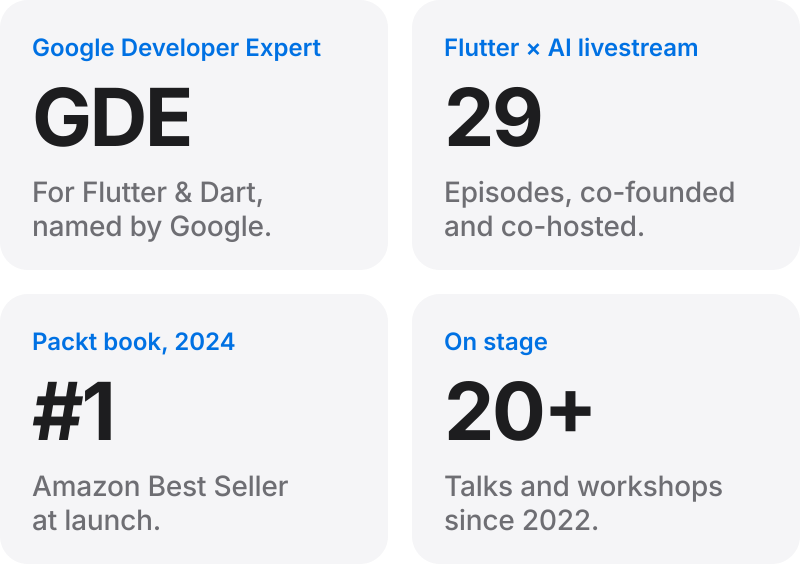
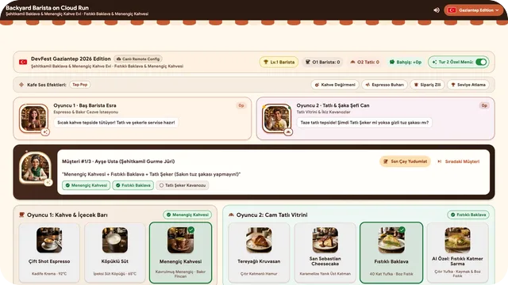
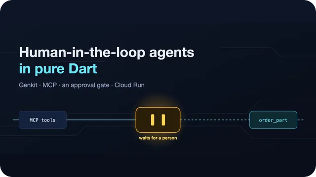
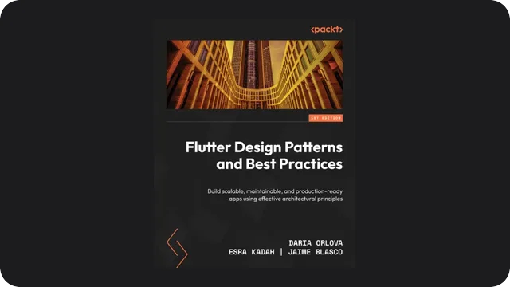
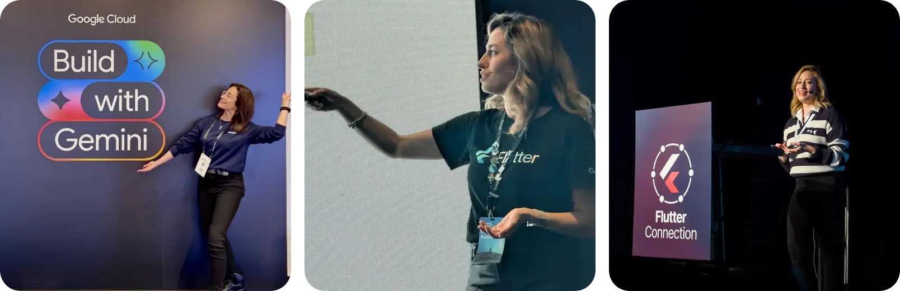
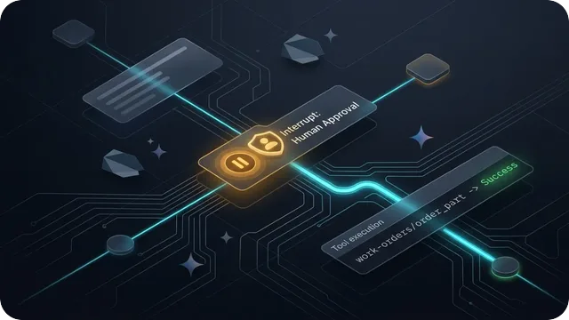
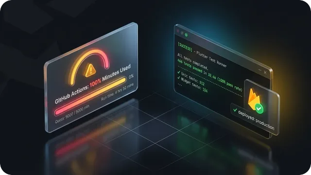
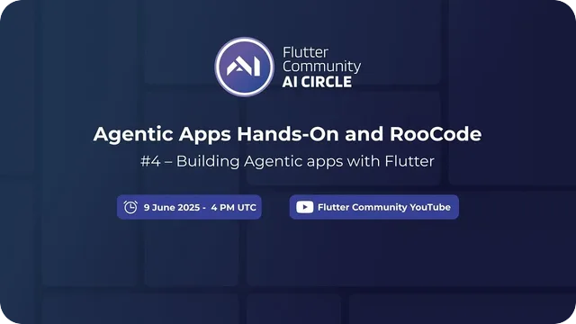
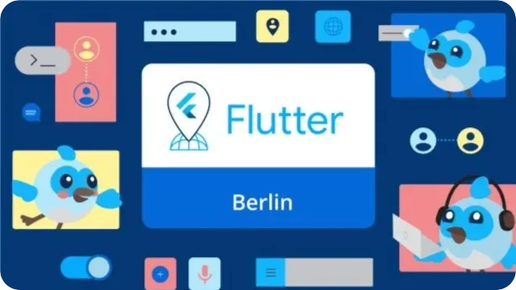

  

  <picture>
    <source media="(prefers-color-scheme: dark)" srcset="assets/apple/hero-dark.svg" />
    
  </picture>

  I build production Flutter apps with AI inside them, and show how on stage 🎤 
  Tech Lead at <a href="https://antigua-mobile.com/de/">Antigua Mobile</a>, Berlin 🇩🇪

  <a href="https://esratech.com"><b>esratech.com&nbsp;›</b></a>&emsp;
  <a href="https://esratech.com/cv/"><b>CV&nbsp;›</b></a>&emsp;
  <a href="https://calendar.google.com/calendar/appointments/schedules/AcZssZ3TdESI-2KJtknjVxNWDXkjoInHCyzOlFu2NDv_46tKIoTob-70zJMQQT2uVkn3P8U63LnQUlkN"><b>Book&nbsp;a&nbsp;30&nbsp;min&nbsp;call&nbsp;›</b></a>

  🚀 Open to new roles from January 2027: permanent or freelance, Berlin hybrid or remote.

 

  <a href="https://esratech.com">
    <picture>
      <source media="(prefers-color-scheme: dark)" srcset="assets/apple/stats-dark.svg" />
      
    </picture>
  </a>

 

<picture>
  <source media="(prefers-color-scheme: dark)" srcset="assets/apple/heading-now-dark.svg" />
  
</picture>

| | When | Where | What I'm doing |
|:-:|---|---|---|
| 🇩🇪 | **14 Nov** | [DevFest Berlin](https://2026.devfest-berlin.de) | 🎤 Talk "Dressing Up AI" and ☕ the Vibe Lounge, plus co-organizing |
| 🇹🇷 | **15 Nov** | DevFest Gaziantep | 🛠️ Workshop "Flutter ve Gemini ile production'a çıkmak", in Turkish |
| 🇹🇷 | **29 Nov** | DevFest Eskişehir | 🎤 Flutter session, in Turkish |
| 🇹🇷 | **11 Dec** | DevFest Adana | 🎤 "AI-Powered Applications with Flutter" |

 

<picture>
  <source media="(prefers-color-scheme: dark)" srcset="assets/apple/heading-work-dark.svg" />
  
</picture>

  
  
  

- ☕ [**Backyard Barista**](https://backyard-barista-389486729482.europe-west3.run.app) · a two-player café game in Flutter on Cloud Run. Gemini judges every order and catches the salt you sneak into a sweet latte 🙈 [Code&nbsp;›](https://github.com/esrakadah/devfest-2026-backyard-barista-cloudrun)
- 🤖 [**Genkit + MCP agent**](https://dev.to/gde/human-in-the-loop-agents-in-pure-dart-genkit-mcp-and-an-approval-gate-on-cloud-run-4gmc) · pure Dart, and paid orders wait until a person says yes. I hit a bug on the way and [fixed it upstream](https://github.com/genkit-ai/genkit-dart/pull/658) 💪
- 🎬 **SoundStage** · six takes of one song, lined up by a Dart FFT in 1.6 seconds on an iPhone 🔥
- 👗 [**modemoiselle**](https://modemoiselle.web.app) · my wardrobe app with Flutter and Gemini, live with 841 tests
- 📄 **Document Processor** at Antigua · Gemini on Vertex AI reads German property PDFs and flags a risk only when it can quote the document
- ⚡️ **EV charging app** at chargecloud · one Flutter app for 100+ white-label brands, plus CompanyOS, our shared docs and Claude Code tooling
- 📘 [**Flutter Design Patterns and Best Practices**](https://github.com/PacktPublishing/Flutter-Design-Patterns-and-Best-Practices) · the Packt book I co-wrote with [Daria Orlova](https://github.com/dariadroid) and [Jaime Blasco](https://github.com/jamesblasco). Navigation and testing are my chapters 🤓

📦 <b>Open source</b>

 

- 🎙️ [**flutter_voice_bridge**](https://github.com/esrakadah/flutter_voice_bridge) · Flutter below the widget layer: platform channels, a C++ FFI wrapper around whisper.cpp, offline transcription on an isolate
- 🗣️ [**esra-whisper-recorder**](https://github.com/esrakadah/esra-whisper-recorder) · offline voice recorder and transcriber for macOS, made for my English, German and Turkish mix
- 🧪 [**patrol-mcp-guide**](https://github.com/esrakadah/patrol-mcp-guide) · AI-assisted Flutter E2E tests with Patrol and MCP
- 🔍 [**agy-setup-audit**](https://github.com/esrakadah/agy-setup-audit) · read-only audit script, branch guard hook and templates for Google Antigravity
- 🛂 [**databricks-price-passport**](https://github.com/esrakadah/databricks-price-passport) · hourly energy prices, each with a passport of the model that made it. Work in progress
- ☕ [**devfest-berlin-2026-vibe-lounge**](https://github.com/esrakadah/devfest-berlin-2026-vibe-lounge) · challenges and sprint guide for the DevFest Berlin Vibe Lounge
- 🙌 Contributions: [genkit-dart](https://github.com/genkit-ai/genkit-dart/pull/658) and the [DevFest Berlin 2026 website](https://github.com/devfest-berlin/2026.devfest.berlin)

 

<picture>
  <source media="(prefers-color-scheme: dark)" srcset="assets/apple/heading-stage-dark.svg" />
  
</picture>

   
  Build with Gemini 2026 · DevFest Istanbul 2025 · Flutter Connection 2024, Paris

- 🛠️ [**Google Cloud Build with Gemini, Track 2**](https://esratech.com/build-with-gemini-antigravity/) · facilitator, Oct 2026
- 🎤 [**Is Flutter a Smart Bet in an AI-Driven Job Market?**](https://www.nextappcon.com/) · roundtable with Ivanna Kaceviča at next.app devCon, Oct 2026
- 🎤 **Beyond Chatbots: When AI Owns the Interface** · Flutter Berlin Meetup, Aug 2026
- 🎤 **Beyond Chatbots: Building Agentic Interfaces with Flutter GenUI and A2UI** · Google Cloud Builders Day Berlin, Mar 2026
- 🎤 **The Flutter Way: FFI, Pigeon & On-Device AI** · DevFest Istanbul, Edirne and Konya, 2025

🎤 <b>All talks, workshops and sessions</b>

 

- 🎤 **Flutter at Native Speed: The FFI and Platform Channels Way** · DevFest Berlin 2024 and 2025, DevFest Kocaeli 2025, Flutter Heroes 2024 (Turin), GDG Berlin
- 📺 [**Flutter Vibes Only**](https://www.youtube.com/watch?v=GiqqJdZaqPk) · vibe-coding workshop with Ivanna Kaceviča, FlutterCon EU 2025 and Flutter & Friends 2025
- 🌸 [**Flutter Vibes Only for Groundbreaker Talents**](https://www.linkedin.com/posts/be-a-groundbreaker_flutter-womenintech-aiintech-activity-7402633497124745216-3TWD) · mentoring 40+ scholarship recipients, online, Dec 2025
- 🎤 **AI in Flutter Development: What's Actually Useful?** · roundtable, next.app devCon / FlutterCon EU 2025, Berlin
- 🛠️ **Bridging the Gap: Extending Flutter Beyond Its Limits** · workshop with Simon Auer, WeAreDevelopers World Congress 2025, Berlin
- 📺 [**From Touch To Code: Gestures and Beyond**](https://www.youtube.com/watch?v=_wDFAA1Pl80) · Flutter Connection 2024 (Paris), Flutter Berlin meetup, FlutterCon EU 2024
- 📺 [**Flutter & Friends 2024, main stage panel**](https://www.youtube.com/live/7Dx54EZiMAY?t=28122) · moderated by Alek Åström
- 🎤 **Build and Ship a Flutter App in 40 Minutes** · DevFest Edirne 2023
- 🎤 **Coding Outside the Box: The Developer's Role in User Experience and Design Systems** · FlutterCon × droidcon Berlin 2023
- 🌸 **Flutteristas Panel** · fluttercon Berlin 2023
- 🎤 **Flutter Extraordinaire: Create Stunning Apps with Elegance and Style** · DevFest Women 2022, Google Istanbul
- 📺 [**Let's Build a Flutter App, Fast!**](https://www.youtube.com/watch?v=lYhBHvyLm6E) · a Flutter and Firebase chat app live in about 40 minutes, Flutter Ottawa and more meetups and DevFests
- 📺 [**AI Coding Assistants in Your Flutter Routine**](https://www.youtube.com/live/ftTXXAx8AxM?t=37625) · Flutteristas Conference
- 📺 [**Cleaner Flutter Code with Dart 3**](https://www.youtube.com/watch?v=pnh3xTR7D70) · Flutter Tel Aviv
- 📺 [**Tests in Flutter: Making Sure Your Code Works**](https://www.youtube.com/watch?v=H2OykY1FPb8&t=14435s) · Flutter Festival Turquoise
- 📺 [**Takeaways from Flutter Forward 2023**](https://www.youtube.com/watch?v=zoXFggMHCKw) · Google DSC Piri Reis University, in Turkish
- 📺 [**Humpday Q&A with Craig Labenz**](https://www.youtube.com/watch?v=HryfB44en0w) and [**with Jhin Lee**](https://www.youtube.com/watch?v=1U-zd6MYrOA&t=877s) · Flutter Community

Abstracts and the talks I offer: [Sessionize&nbsp;›](https://sessionize.com/esrakadah)

 

<picture>
  <source media="(prefers-color-scheme: dark)" srcset="assets/apple/heading-writing-dark.svg" />
  
</picture>

  
  

- ✍️ [**I approved the order. Then my Genkit Dart agent forgot its own tool.**](https://dev.to/gde/i-approved-the-order-then-my-genkit-dart-agent-forgot-its-own-tool-3mjp) · dev.to, Oct 2026
- ✍️ [**Shipping Flutter Web to Firebase When Your GitHub Actions Budget Hits Zero**](https://dev.to/gde/shipping-flutter-web-to-firebase-when-your-github-actions-budget-hits-zero-2mi5) · dev.to, Oct 2026
- ✍️ [**Human-in-the-Loop Agents in Pure Dart: Genkit, MCP and an Approval Gate on Cloud Run**](https://dev.to/gde/human-in-the-loop-agents-in-pure-dart-genkit-mcp-and-an-approval-gate-on-cloud-run-4gmc) · dev.to, Oct 2026
- 📝 [**Building Agentic Apps with Gemini & Antigravity: Track 2 Field Notes**](https://esratech.com/build-with-gemini-antigravity/) · esratech.com, Oct 2026

 

<picture>
  <source media="(prefers-color-scheme: dark)" srcset="assets/apple/heading-community-dark.svg" />
  
</picture>

  
  

- 🤖 [**Flutter Community AI Circle**](https://esratech.com/flutter-community-ai-circle-fcaic/) · I co-founded it and co-host it. Flutter, Dart and AI, live since May 2025 · [YouTube&nbsp;›](https://www.youtube.com/playlist?list=PL4dBIh1xps-HIYvaEIbLWHZqt_WGBfpx3)
- 🌸 [**Flutteristas**](https://flutteristas.org/) · co-organizer, for women and non-binary people in Flutter
- 💙 [**Flutter Berlin**](https://www.meetup.com/de-de/flutter-berlin/) · co-organizer
- 🥳 [**DevFest Berlin**](https://2026.devfest-berlin.de) · co-organizer and website contributor
- ☁️ [**GDG Cloud Berlin**](https://gdg.community.dev/gdg-cloud-berlin/) · co-lead
- 🇹🇷 [**GDG Cloud Istanbul**](https://gdg.community.dev/gdg-cloud-istanbul/) · co-organizer, 2020 to 2023

✨ Google for Developers featured me: [my community story&nbsp;›](https://developers.google.com/community/stories/story-d0e9a388)&emsp;[Developers Blog, 2022&nbsp;›](https://developers.googleblog.com/en/celebrating-global-women-in-tech-and-trailblazers/)

 

  🌐 <a href="https://esratech.com">esratech.com</a> ·
  💼 <a href="https://linkedin.com/in/esratech">LinkedIn</a> ·
  🦋 <a href="https://bsky.app/profile/esratech.bsky.social">Bluesky</a> ·
  𝕏 <a href="https://x.com/esratech">X</a> ·
  📸 <a href="https://www.instagram.com/esra.tech">Instagram</a> ·
  🎤 <a href="https://sessionize.com/esrakadah">Sessionize</a> ·
  ✉️ <a href="mailto:hello@esratech.com">hello@esratech.com</a>

